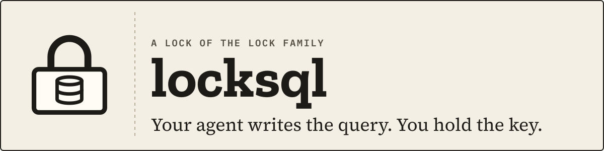
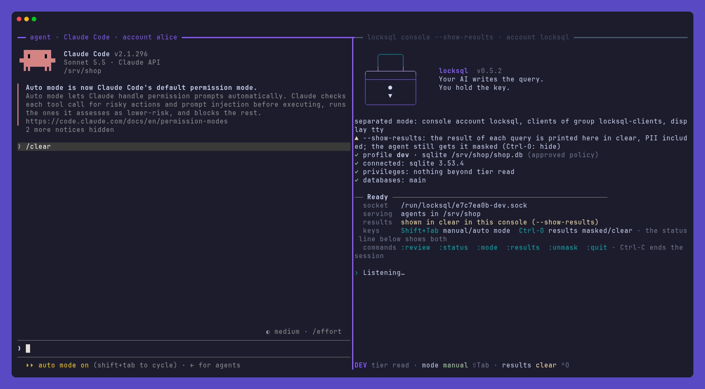
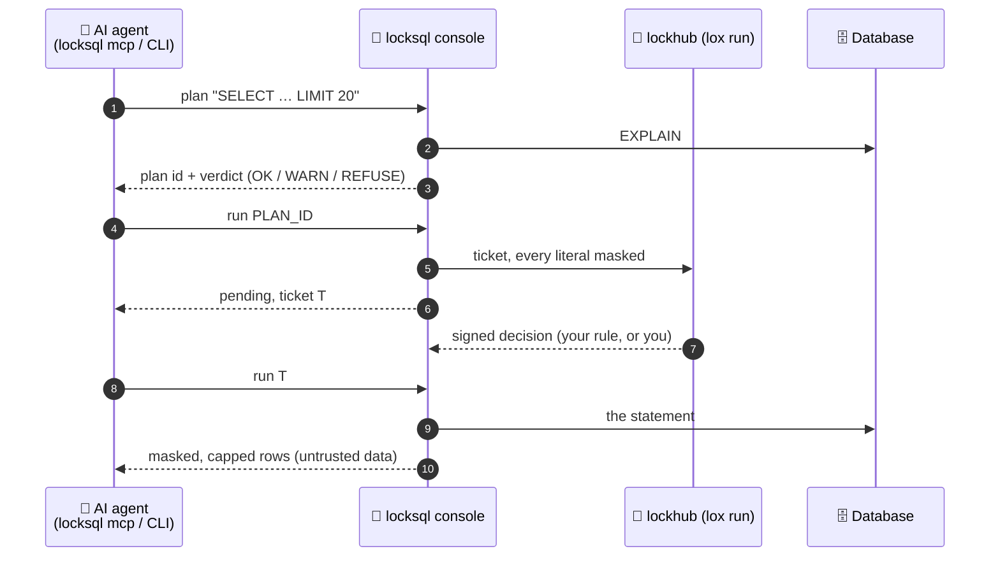

<p align="center">
  <picture>
    <source media="(prefers-color-scheme: dark)" srcset="docs/assets/banner-dark.svg">
    
  </picture>
</p>

<p align="center">
  <a href="https://github.com/DavidGodefroid/locksql/actions/workflows/ci.yml"></a>
  <a href="https://github.com/DavidGodefroid/locksql/releases"></a>
  <a href="LICENSE"></a>
  <a href="go.mod"></a>
</p>

<p align="center"><b>Let any AI agent query your SQL databases: personal data comes back masked,<br>
connections and writes wait for you, and the agent never holds a password.</b></p>

<p align="center">
  
</p>
<p align="center"><sub>An agent (here Claude Code, left) and the locksql console (right). Recorded before approvals moved to lockhub: today you answer in <code>lox run</code>, and masked cells come back as plain <code>&lt;redacted&gt;</code>.</sub></p>

<p align="center">
  <a href="#quick-start">Quick start</a> ·
  <a href="#how-it-works">How it works</a> ·
  <a href="#documentation">Docs</a> ·
  <a href="#the-lock-family">Lock Family</a> ·
  <a href="https://locksql.com">locksql.com</a>
</p>

---

locksql is a Lock of the [Lock Family](https://github.com/DavidGodefroid/lockfamily),
harness security for AI agents. A **console** sits between your agent and
MariaDB, MySQL, PostgreSQL or SQLite: it holds the credentials, weighs every
statement and masks personal data. The agent only asks.

> [!NOTE]
> **Pre-release** (`v0.17.x`): a release may still change the config files,
> the MCP tools or the CLI. See [the path to 1.0](docs/1.0.md).

## Why locksql

- **The agent never holds a password.** Credentials are typed at console
  start or read from Vault, in an account and a container the agent cannot reach.
- **Approval outside the agent.** Each statement becomes a ticket on
  [lockhub](https://github.com/DavidGodefroid/lockhub), decided in `lox run`.
  Reads pass on your rules; connections, writes and schema changes wait for you.
- **Personal data stays masked.** Every output column is traced to its source
  column and masked there, whatever the query calls it.
- **Fail closed.** What the classifier cannot classify with certainty is
  refused, with a code the agent can act on.

In-agent approval is a convenience; a separate approval process is a boundary.

## Install

```sh
brew trust davidgodefroid/tap
brew install davidgodefroid/tap/lox davidgodefroid/tap/locksql
```

locksql runs in Docker: Homebrew installs the `locksql` launcher, which runs
every command in the release's image. `lox` is lockhub's CLI. The whole
family instead: `brew install davidgodefroid/tap/lockfamily`.

Without Homebrew, the signed install script of a release:

```sh
V=vX.Y.Z
curl -fsSLO "https://raw.githubusercontent.com/DavidGodefroid/locksql/$V/scripts/install.sh"
less install.sh
LOCKSQL_VERSION=$V sh install.sh
```

Linux and macOS; on Windows, WSL 2 with Docker Desktop. Launcher, image,
Vault image, lea and building from source: [docs/install.md](docs/install.md).

## Quick start

1. In your project, add the database. `lox add` asks where it is (never
   the password), writes the profile, wires your agent and starts the console:

   ```sh
   lox add locksql
   ```

2. In a terminal of its own, outside any agent, keep `lox run` open. Every
   ticket shows up there:

   ```sh
   lox run
   ```

3. Start your agent in the project (`claude`, `codex`, `gemini`, …) and ask:
   *"how many orders were placed yesterday?"*

`lox add` wires Claude Code; for Codex, Cursor or Gemini CLI, also run
`locksql init codex` (or `cursor`, `gemini`). With
[lea](https://github.com/DavidGodefroid/lea), run `lox add` in lea's projects
directory, then `lea stop` and `lea`. Step by step, by hand:
[docs/install.md](docs/install.md#first-query-step-by-step).

## Highlights

<table>
<tr>
<td width="50%" valign="top">

**🔑 One key holder**<br>
Credentials live in the console only: never in argv, env, files, logs, the
socket or an error message.

</td>
<td width="50%" valign="top">

**👤 Your rules, your decisions**<br>
Per profile, each action is `auto`, `ask` or `deny`. By default reads pass;
writes, DDL and unmasked reads are asked every time.

</td>
</tr>
<tr>
<td valign="top">

**🕶️ PII masked at the source**<br>
Columns are traced through aliases, CTEs, unions and joins, then masked
(`redact`, `partial`, `email`); detectors catch the rest.

</td>
<td valign="top">

**⚖️ Weighed before it runs**<br>
`LIMIT` is mandatory, `EXPLAIN` runs first, and plans that would scan too
many rows are refused.

</td>
</tr>
</table>

More: [OS separation, grants, writes, remote databases](docs/safety.md), and
[the console's switches](docs/console.md).

## How it works

Two processes in two containers. Only the console holds the key.



1. The agent plans a statement (`locksql plan`, or the `locksql_plan` MCP
   tool). The console classifies it, traces every output column, runs
   `EXPLAIN` and answers with a verdict.
2. The agent runs the plan. The console sends lockhub a ticket and answers
   `pending`.
3. `lox run` decides, on your profile's rules or by asking you. The console
   checks the signed decision, runs the statement, masks and caps the rows.

Engines: MariaDB 10.1+, MySQL 8.0+, PostgreSQL 13+, SQLite 3, all pure Go,
on amd64 and arm64. The approval screen, the process layout and the engines
table: [docs/architecture.md](docs/architecture.md).

## Safety model

- **The console is the enforcement point.** Skills, rules and MCP tool
  descriptions only guide the agent; the console's checks are the guarantee.
- **OS separation.** The console runs as its own account in its own
  container; the kernel checks every peer on the socket.
- **The AI tightens, the human loosens.** Agents may add mask rules; any
  loosening of the policy waits for your confirmation in the console.
- **Audit.** Every decision, refusal and run goes to an append-only JSONL log,
  never with secrets or row data.
- **Known limits.** Masking is best effort, k-anonymity is a warning, and
  whoever can run `docker` commands can reach the console's container.

Every rule and limit: [docs/safety.md](docs/safety.md). Threat model:
[docs/security-model.md](docs/security-model.md).

## Documentation

| Doc | What it covers |
|---|---|
| [docs/install.md](docs/install.md) | install paths, the launcher and its image, the first query by hand, building |
| [docs/docker.md](docs/docker.md) | what runs where in Docker, Vault, an agent in its own container |
| [docs/usage.md](docs/usage.md) | the console, client commands, MCP server, agent wiring, grants, auto mode |
| [docs/configuration.md](docs/configuration.md) | every profile key, TLS, SSH, PII rule sets, sharing a configuration |
| [docs/console.md](docs/console.md) | `--allow-unmask`, console keys, clear results (Ctrl-O) |
| [docs/architecture.md](docs/architecture.md) | the life of a query, the approval screen, engines |
| [docs/safety.md](docs/safety.md) | the safety model and the limitations, in full |
| [docs/security-model.md](docs/security-model.md) | threat model, mitigations, upstream recommendation |
| [docs/pii-analysis.md](docs/pii-analysis.md) | how the PII analysis works (for contributors) |
| [docs/1.0.md](docs/1.0.md) | the 1.0 criteria and the versioning policy |
| [CHANGELOG.md](CHANGELOG.md) | what changed, release by release |

The site, [locksql.com](https://locksql.com), is built from [`site/`](site/).

## The Lock Family

| Repo | What it does |
|---|---|
| [lockfamily](https://github.com/DavidGodefroid/lockfamily) | The family site ([lockfamily.dev](https://lockfamily.dev)) and the one-line installer. |
| [locksql](https://github.com/DavidGodefroid/locksql) | SQL databases: the agent queries, PII comes back masked; connections and writes wait for you. |
| [lockmq](https://github.com/DavidGodefroid/lockmq) | RabbitMQ: masked queue inspection; reading messages and acting on queues wait for you. |
| [lockfile](https://github.com/DavidGodefroid/lockfile) | Files (S3, SFTP, disk): the agent asks yes/no questions about files it never reads. |
| [lockhttp](https://github.com/DavidGodefroid/lockhttp) | Outbound HTTP(S): reads of trusted hosts pass; anything that sends data or reaches an unknown host waits for you. |
| [locklog](https://github.com/DavidGodefroid/locklog) | Logs: masked, bounded log search; the agent reads the logs, not the people in them. |
| [lockssh](https://github.com/DavidGodefroid/lockssh) | Commands over SSH: allow-listed commands run at once, the rest waits for you; the key never leaves the console. |
| [lockhub](https://github.com/DavidGodefroid/lockhub) | The approval hub and its `lox` CLI: `lox run` approves outside the agent's harness and never sees values in clear. |
| [lockkit](https://github.com/DavidGodefroid/lockkit) | The shared Go core of every Lock: console, policies, masking, signed tickets, audit, MCP. |
| [lea](https://github.com/DavidGodefroid/lea) | Runs many agents in containers, wired to the Locks. |

## Contributing · Security · License

- **Contributing:** [CONTRIBUTING.md](CONTRIBUTING.md). Build with
  `CGO_ENABLED=0 go build ./cmd/locksql` (Go 1.26+).
- **Security:** report a vulnerability privately, see [SECURITY.md](SECURITY.md).
- **License:** Apache License 2.0, see [LICENSE](LICENSE) and [NOTICE](NOTICE).
