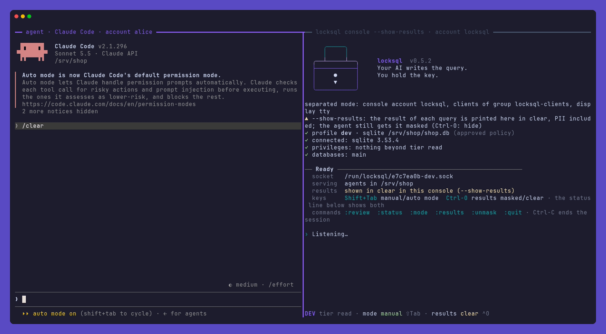
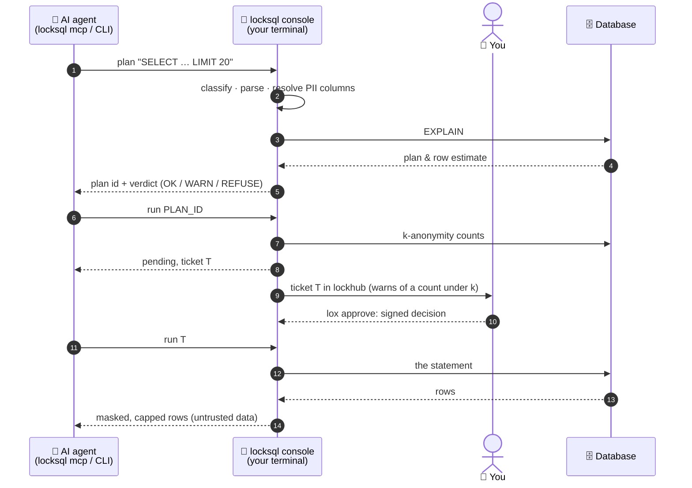

<p align="center">
  <picture>
    <source media="(prefers-color-scheme: dark)" srcset="docs/assets/banner-dark.svg">
    
  </picture>
</p>

<p align="center">
  <a href="https://github.com/DavidGodefroid/locksql/actions/workflows/ci.yml"></a>
  
  
  
  <a href="LICENSE"></a>
</p>

<p align="center">
  <b>Let Claude Code, Codex, Cursor or Gemini CLI query your databases<br>
  without ever handing them a password.</b>
</p>

<p align="center">
  <a href="#quick-start">Quick start</a> ·
  <a href="#how-it-works">How it works</a> ·
  <a href="#safety-model">Safety model</a> ·
  <a href="#configuration">Configuration</a> ·
  <a href="docs/usage.md">Docs</a>
</p>

---

locksql puts a **console** between your AI agent and MariaDB, MySQL,
PostgreSQL or SQLite. The agent proposes SQL; the console holds the
credentials, parses and weighs every statement, masks personal data and
sends it to [lockhub](https://github.com/DavidGodefroid/lockhub), where
**you** approve it (`lox approve`). The agent never sees a credential and
never opens a connection. The console runs attached to lockhub only:
`lox up` starts it.

<p align="center">
  
</p>
<p align="center"><sub>Claude Code (left, account <code>alice</code>) and the locksql console (right, account <code>locksql</code>, started with <code>--show-results</code>). Recorded before the console ran attached to lockhub only: approvals are now given in lockhub, and placeholders and cell references are refused.</sub></p>

> [!NOTE]
> **Pre-release** (`v0.13.x`). See [Install](#install).

## Why locksql?

Agent tools already ask before running a command, but that approval lives
inside the agent's own process: the agent holds the credentials, the prompt
can be configured away, and a long session trains you to press "yes".
locksql moves the decision **out of the agent**.

| | In-agent approval | locksql |
|---|:---:|:---:|
| Agent never sees the DB password | ❌ | ✅ |
| Agent has no DB connection | ❌ | ✅ |
| Approval cannot be switched off from the agent side | ❌ | ✅ |
| Every read parsed down to its source columns | ❌ | ✅ |
| `EXPLAIN` cost check before running | ❌ | ✅ |
| PII masked on its source column, not its label | ❌ | ✅ |
| k-anonymity warning on PII filters and aggregates | ❌ | ✅ |
| Search on a PII value the agent never sees | ❌ | ✅ |
| Policy loosening needs a human confirmation | ❌ | ✅ |
| Append-only audit log | ❌ | ✅ |

In-agent approval is a convenience; a separate approval process is a boundary.

## Highlights

<table>
<tr>
<td width="50%" valign="top">

**🔑 One key holder**<br>
Credentials are typed at console start or fetched from HashiCorp Vault. Never in argv, env, files, logs, the socket or error
messages.

</td>
<td width="50%" valign="top">

**👤 Human in the loop**<br>
Every statement goes to lockhub with its plan, cost and PII footprint, and
runs only once you approve it there (`lox approve`).

</td>
</tr>
<tr>
<td valign="top">

**🧱 Fail closed**<br>
A dialect-aware classifier refuses anything it cannot classify with certainty.
Reads are parsed in full; unknown syntax is refused.

</td>
<td valign="top">

**🕶️ PII masking**<br>
Every output column is traced to its source through aliases, CTEs, unions and
joins, then masked (`redact` by default, `partial` or `email`).

</td>
</tr>
<tr>
<td valign="top">

**⚖️ Weight check**<br>
`LIMIT` is mandatory, `EXPLAIN` runs first, and plans that would scan too many rows
are refused before they run.

</td>
<td valign="top">

**🛡️ OS separation**<br>
The console runs under its own account in its own container; the kernel
checks every peer on the socket.

</td>
</tr>
<tr>
<td valign="top">

**🔎 Literals masked on the ticket**<br>
The ticket lockhub shows carries every literal of the statement masked;
the clear screen is revealed or sealed to your pinned devices only.

</td>
<td valign="top">

**👁️ Clear for you only**<br>
Ctrl-O in the console prints the clear rows there while the agent gets
them masked; `--allow-unmask` (or `:unmask` in the console) is the only
way an agent can ask for raw PII.

</td>
</tr>
<tr>
<td colspan="2" valign="top">

**🔐 Remote, verified**<br>
TLS verifies the server certificate by default (`tls = "verify-full"`), and an
`ssh` table reaches a database behind a bastion: the console opens the tunnel
itself, checks the bastion's host key and listens on no local port.

</td>
</tr>
</table>

## Quick start

locksql runs in Docker: nothing on your machine but Docker and the
`locksql` launcher, which runs every command in the image. The console runs
under [lockhub](https://github.com/DavidGodefroid/lockhub), which starts it
and where you decide each query.

The shortest path is the Lock Family's: install it with Homebrew, then let
[`lox init`](https://github.com/DavidGodefroid/lockhub/blob/main/docs/lox-init.md)
find your database and set up its lock:

```sh
brew trust davidgodefroid/tap                # Homebrew asks you to trust a third-party tap once
brew install davidgodefroid/tap/lockfamily   # or only this tool: brew install davidgodefroid/tap/locksql
cd ~/projects                                 # with lea: its projects directory; with claude: the project
lox init                                      # detects PostgreSQL / MySQL / MariaDB, sets up the lock, runs lox up
lea                                           # or: claude, then lox approve
```

By hand, with locksql's own installer, a first approved query from your
project directory:

```sh
# 1. Install the launcher (it runs every locksql command in Docker)
V=vX.Y.Z
curl -fsSLO "https://raw.githubusercontent.com/DavidGodefroid/locksql/$V/scripts/install.sh"
less install.sh && LOCKSQL_VERSION=$V sh install.sh

# 2. In your project: Claude Code's files (its MCP server is `locksql mcp`),
#    a database profile, then doctor --fix (your agents, .locksql/ as lox up reads it)
locksql init claude
locksql profile add
locksql doctor --fix --yes

# 3. Declare the lock in lockhub and start it: lox up starts the console,
#    lox attach answers its questions (the policy, the PII rules, the password)
lox add locksql sql-dev
lox up
lox attach sql-dev
```

Then ask your agent, in the project: "how many orders were placed
yesterday?". Each query waits for your decision in lockhub:

```sh
lox approve
```

`locksql console` is started by `lox up` only: without its hub flags
(`--hub`, `--hub-key-file`, `--instance`) it exits with ``launched by `lox up` only``.

The console runs as the `locksql` account (uid 10001) in its own container,
the only one that holds the database credentials. The agent's MCP server runs
as `agent` (uid 10002) in a throwaway container. The two share only the
console's socket volume, which `lox up` names in `.lockfamily/up.json` and the
launcher mounts read-only once Docker confirms it is lox up's
([docs/launcher.md](docs/launcher.md#the-socket-of-lox-ups-lock)); the kernel
checks every peer on the socket.

`init claude` writes `.mcp.json` with `locksql mcp`: the launcher, which
starts the MCP server in the image (Codex, Gemini CLI and Cursor take the
same command). `profile add` asks for the engine, host, TLS and where the
password comes from (typed at console start, or Vault), never for the
password itself; `--non-interactive` takes them from flags instead, and
`--json` answers in one line of JSON, as `lox init` calls it
([docs/usage.md](docs/usage.md#locksql-profile-add)). Inside a container `localhost` is the container: a database
on your machine is `host.docker.internal`, which the launcher maps to your
machine. `locksql version` prints the launcher's version and its image's,
`locksql update` updates both. What runs where, Vault, and an agent that
itself runs in a container are in [docs/docker.md](docs/docker.md).

## How it works

Two processes in two containers. Only the console holds the key.



1. The agent submits SQL with `locksql plan` (or the `locksql_plan` MCP tool).
   The console classifies it, parses and analyses a read down to the source
   column of every output, runs `EXPLAIN`, weighs the plan and returns a
   one-shot plan id with a verdict (`OK`, `WARN` or `REFUSE`).
2. The agent calls `locksql run PLAN_ID`. When the statement filters, groups
   or aggregates PII, the console first runs its k-anonymity counts. It prints
   the approval screen in its terminal, sends the request to lockhub as a
   ticket (every literal masked, with a `k-anonymity` warning for each count
   under `k_anonymity`) and answers the agent `pending` with the ticket:

   ```
   ╭─ DEV · 127.0.0.1 / app · user alice · tier read ─────
   │ requested by uid 1000 (alice) · pid 48211 (claude)
   │ agent: list the Belgian customers to check the email campaign
   │
   │   SELECT id, email FROM customers WHERE country = 'BE' LIMIT 20
   │
   │ class READ · EXPLAIN: customers range ~410 · est. 410 rows examined · verdict OK
   │ reads: app.customers
   │ returns at most 20 rows
   │ PII columns touched: customers.email (select)
   │ masked outputs: email → redact
   │ PII: masked (4 column rules; detectors: email, phone, iban, card)
   ╰─ pending: ticket 01J…
   ```

3. You decide the ticket in lockhub (`lox approve`). The agent runs the
   ticket (`locksql run TICKET`); the console checks the hub's signed
   decision, plans the statement again, runs it, masks PII, caps the output
   and hands the rows back to the agent, framed as untrusted data.

<details>
<summary>Process layout</summary>

```
 Console container (your terminal)                Agent's container
 ┌───────────────────────────────────┐            ┌──────────────────────────────┐
 │ locksql console --profile dev     │ socket     │ locksql mcp   (stdio MCP)    │◄── AI agent
 │  credentials (ask | Vault)        │ volume     │ locksql plan|run|status|pii  │◄── AI via shell
 │  policy · classifier · EXPLAIN    │◄──────────►│ no secrets, no DB connection │
 │  approval prompt · masking · audit│  JSON-RPC  └──────────────────────────────┘
 └─────────────────┬─────────────────┘
                   │ native protocol
                   ▼
        MariaDB · MySQL · PostgreSQL · SQLite
```

</details>

Full walkthrough: [docs/usage.md](docs/usage.md).

## Engines

| Engine | Versions | Read-only session (tier `read`) | Server-side timeout | Plan source |
|---|---|---|---|---|
| `mariadb` | 10.1+ (tested 10.11, 11.4) | `SET SESSION TRANSACTION READ ONLY` + `START TRANSACTION READ ONLY` | `max_statement_time` + `KILL QUERY` | `EXPLAIN FORMAT=JSON` |
| `mysql` | 8.0+ (tested 8.0, 8.4) | same as MariaDB | `max_execution_time` (SELECT only; writes rely on `KILL QUERY`) + `KILL QUERY` | `EXPLAIN FORMAT=JSON` |
| `postgres` | 13+ (tested 13, 17) | `SET SESSION CHARACTERISTICS AS TRANSACTION READ ONLY` + `BEGIN READ ONLY` … `ROLLBACK` | `statement_timeout` + cancel request | `EXPLAIN (FORMAT JSON, VERBOSE)` |
| `sqlite` | 3 (pure Go, in-process) | `mode=ro` + `query_only` | interrupt on deadline | `EXPLAIN QUERY PLAN` + `sqlite_stat1` (run `ANALYZE` once, or every full scan is a WARN of unknown size) |

All engines are pure Go: the binary is built with `CGO_ENABLED=0`. locksql
runs in Linux containers, on amd64 and arm64, wherever Docker runs
([docs/docker.md](docs/docker.md)).

## Safety model

The console is the enforcement point. Skills, rules and MCP tool descriptions
only guide the agent; the console's checks are the guarantee.

- **One key holder.** Credentials are typed at console start (no echo), or
  fetched from HashiCorp Vault with the `vault` CLI
  at every connection (`credentials = "vault"`, suited to the database
  secrets engine's per-user, short-lived logins). They never appear in argv,
  environment, files, logs, the socket protocol or error messages. The
  console disables core dumps. `credentials_ttl` makes it ask again after a
  set time; a Vault lease is renewed with a fresh login before it ends.
- **OS separation.** The image holds a `locksql` console account and a
  `locksql-clients` group: the console runs as that account in its own
  container, the agent's MCP server runs as `agent`, a member of the group, in
  another, and the two share only the socket volume. The kernel checks every
  peer. The console refuses to start without this setup, since an agent in
  the console's own account could read or type into its terminal. Whoever can
  run `docker` commands can still reach the console's container: see
  [what Docker does and does not separate](docs/docker.md#what-docker-does-and-does-not-separate).
- **Human approval.** Every statement goes to lockhub as a ticket and runs
  only once lockhub's signed decision approves it; no socket method can
  approve. You can deny with a reason the agent reads. The console's own
  decisions (a loosened policy, `:unmask`) stay at its terminal.
- **Fail closed.** A dialect-aware classifier refuses anything it cannot
  classify with certainty: several statements, comments, variables, bind
  parameters, file and OS access, sleeps and locks, session tampering. Reads
  are limited to `SELECT`, `WITH ... SELECT` and `EXPLAIN SELECT`, parsed in
  full: unknown syntax, functions outside an allowlist and system schemas
  are refused.
- **Tiers.** `read < write < ddl < admin`; the default is `read`. Tier `read`
  is also enforced server side (read-only session and transaction).
- **Weight check.** A READ statement must carry `LIMIT n` with `n <= max_rows`.
  The console runs `EXPLAIN` and refuses statements that would examine too
  many rows (or cost more than `explain_cost_refuse`); a recursive CTE is at
  least WARN on PostgreSQL and SQLite, whose planners only guess how often it
  iterates; REFUSE cannot be overridden from the console.
- **PII masking.** At every start the console scans the schema and proposes
  rules for columns that look like personal data (multilingual names and
  types) and that no rule names yet. Every output column is resolved to its
  source columns through aliases, functions, subqueries, CTEs, unions, joins
  and `*`, and masked on that source, not on its label; the engine's origin
  metadata is a second check, and a result whose columns do not match the
  analysis is dropped. Value detectors (email, phone, IBAN, card, opt-in
  national ids) mask the other cells. Mask modes: `redact` (the default),
  `partial`, `email`. Quasi-identifiers (birth date, postal code, gender) are
  never masked unless you accept them one by one, since masking blocks range
  filters, `LIKE` and `ORDER BY` on the column.
- **Statement text.** While mask rules exist, the views that hold the text of
  past statements are refused, in reads and in writes: `pg_stat_statements`
  and `pg_stat_activity`; on MySQL and MariaDB,
  `information_schema.PROCESSLIST`, every `performance_schema` and `sys`
  relation, `mysql.general_log` and `mysql.slow_log`.
- **PII usage.** PII columns may be selected, counted, joined with `=` and
  filtered with `=`, `IN (literals)` or `IS NULL`. Expressions over them,
  `LIKE`, ranges and `ORDER BY` are refused. A filter, grouping or aggregate on
  PII that covers fewer than `k_anonymity` rows (default 5, production 10)
  warns you on the ticket, since it could single out one person; you decide.
  The warning is kept in the audit log. The agent is told nothing of the
  count.
- **No typed values.** Placeholders (`col = '${email}'`) and cell
  references (`col = '${r1.2.3}'`) are not supported: a statement holding
  one is refused at plan time (`E_PLACEHOLDER`), since no value is typed in
  lockhub, and masked cells come back as plain `<redacted>`. The approval screen warns, in red and in the
  audit log, when the agent put a clear value in its statement. Warnings
  never refuse and never carry a value.
- **Quiet failures.** Clients get a generic message, never the server's error
  text, and no timings; once the statement is approved, `query.run` answers
  on a 250 ms quantum (a refusal before approval is not quantized).
- **The AI tightens, the human loosens.** Agents may add mask rules and
  request changes. A config edit that loosens the policy (higher tier, larger
  limits, new host, removed PII rule, ...) only takes effect after you
  confirm it in the console.
- **Audit.** Every login, policy change, refusal, decision, run, catalog
  read and logout is appended to a JSONL audit log (mode 0600): the approval
  before the statement runs, its outcome after. The records of a client
  request name the requester: its uid, pid and account. Never secrets, never
  row data.

Details and threat model: [docs/security-model.md](docs/security-model.md).

## Configuration

Profiles live in `.locksql/config.toml` at the project root (found by walking
up from the current directory) and in `<user config dir>/locksql/config.toml`.
A project profile wins over a user profile of the same name. No file ever
holds a secret: keys named like `password`, `passwd`, `pwd`, `secret` or
`token`, and DSNs with an embedded password, are refused.

> **Breaking change.** A remote profile with no `tls` setting now verifies
> the server certificate (`tls = "verify-full"`). A server with a private CA
> needs `tls_ca`; to keep encryption without verification, set
> `tls = "require"`. Until then its connection fails with an error that
> names both settings.

```toml
[profiles.uat]
engine      = "mariadb"             # mariadb | mysql | postgres | sqlite
host        = "db.uat.example.com"  # or path = "app.db" for sqlite
port        = 3306                  # default 3306, or 5432 for postgres
user        = ""                    # empty: asked at console start
database    = ""                    # empty: chosen per query (--db)
credentials = "ask"                 # ask | keychain | vault
tls         = "verify-full"         # disable | prefer | require | verify-ca | verify-full
tls_ca      = ""                    # optional PEM bundle replacing the system roots
credentials_ttl = "20m"             # optional: ask for the secret again
tier        = "read"                # read | write | ddl | admin
production  = false
detectors   = ["email", "phone", "iban", "card", "be_niss"]

[profiles.uat.limits]
statement_timeout   = "30s"
explain_rows_warn   = 100000
explain_rows_refuse = 1000000
max_rows            = 200
max_cell_chars      = 200
max_output_bytes    = 65536
k_anonymity         = 5
explain_cost_refuse = 0             # engine cost units; 0 = off
idle_timeout        = "20m"         # the session ends after this long idle
max_session         = "4h"          # ... and after this long in all
```

With `credentials = "vault"` the console runs `vault read -format=json
<vault_path>` at every connection, as the console account and with its
environment (`VAULT_ADDR`), and connects with the `username` and `password`
of the secret. The console asks for the Vault token at start and keeps it in
memory for the session. Nothing is stored. See
[Credentials from HashiCorp Vault](docs/usage.md#credentials-from-hashicorp-vault).

```toml
[profiles.reporting]
engine      = "postgres"
host        = "db.internal"
tls         = "verify-full"
credentials = "vault"
vault_path  = "database/creds/reporting-ro"   # or a KV secret: "secret/data/reporting"
```

A database reachable only from a bastion gets an `ssh` table: the console
opens the SSH connection itself, with no local listening port, and verifies
the bastion against the console account's `~/.ssh/known_hosts` (asking on
first use, refusing a changed key). `host` is then the database as seen from
the bastion; keep `tls = "verify-full"` unless the database runs on the
bastion itself. See
[Reaching a remote server through SSH](docs/usage.md#reaching-a-remote-server-through-ssh).
A database that publishes no port (an internal Docker network, a server
bound to its container's loopback) is reached with `proxy_command`, an argv
whose stdin and stdout carry the connection, such as
`["docker", "exec", "-i", "shop-db", "socat", "-", "TCP:127.0.0.1:3306"]`;
see [Databases that publish no port](docs/usage.md#databases-that-publish-no-port).

```toml
[profiles.prod]
engine      = "postgres"
host        = "db.internal"         # as seen from the bastion
tls         = "verify-full"
production  = true

[profiles.prod.ssh]
host        = "bastion.example.com"
port        = 22                    # default 22
user        = "deploy"
auth        = "key"                 # key | agent | password
key         = "~/.ssh/id_ed25519"   # auth = "key" only; the console account's home
credentials = "ask"                 # passphrase or SSH password; default: the profile's
```

<details>
<summary>All profile keys</summary>

| Key | Default | Notes |
|---|---|---|
| `engine` | required | `mariadb`, `mysql`, `postgres`, `sqlite` |
| `host`, `port` | required host; port 3306 / 5432 | a host starting with `/` is a Unix socket (MariaDB/MySQL) |
| `path` | required for sqlite | relative to the project root; the file is never created |
| `user` | asked at start | with `credentials = "vault"`: the secret's `username`; set it only for a secret without one |
| `database` | none | the only database served (and scanned for PII); empty: every database the account can see, chosen per query with `--db` |
| `credentials` | `ask` | `keychain` (not in a container) offers to save the secret after the first successful login; `locksql forget --profile P` removes it. `vault` reads the login from `vault_path` at every connection |
| `vault_path` | required with `credentials = "vault"` | the Vault path read with `vault read`, such as `database/creds/<role>` or `secret/data/<name>`; any change is a loosening |
| `credentials_ttl` | none | a duration of at least `1m` (`"20m"`, `"1h"`): the connection is closed and the secret asked again once it is that old |
| `tier` | `read` | highest statement class allowed |
| `production` | `false` | stricter limits, production banner and typed profile name at console start |
| `detectors` | `email`, `phone`, `iban`, `card` | also `be_niss`, `fr_nir`, `nl_bsn`, `us_ssn` and `phone_loose`; `[]` disables them. `phone` masks `+` and 8 to 15 digits, `00` and 10 to 17 digits, or a national number with a trunk 0 (9 to 11 digits, a first group of at least 2 digits); `phone_loose` adds national numbers without a trunk 0 (`(415) 555-2671`, `612 345 678`: 9 to 11 digits in at least two groups, the first of 2 to 4) and also masks some grouped amounts (`123 456 789`). Every detector reads U+00A0, U+202F and U+2009 as a space and full-width digits as digits |
| `pii_rules` | the profile name, in lower case | the PII rule set, `pii/<set>.toml`; 1 to 64 lower-case letters, digits, `_`, `-` or `.`; profiles on isomorphic databases share a set by naming it; any change is a loosening |
| `limits.statement_timeout` | 30s (production 10s) | |
| `limits.explain_rows_warn` | 100 000 (production 20 000) | |
| `limits.explain_rows_refuse` | 1 000 000 (production 200 000) | |
| `limits.max_rows` | 200 | upper bound for `LIMIT n` and for returned rows |
| `limits.max_cell_chars` | 200 | longer cells are cut with `…` |
| `limits.max_output_bytes` | 65 536 | output is cut with a marker |
| `limits.k_anonymity` | 5 (production 10) | a PII filter, a group or an aggregate of a PII column covering fewer rows warns on the approval screen (it no longer refuses); lowering it is a loosening |
| `limits.reference_probe` | 5 | no effect: cell references are not supported; kept so that existing configs load (raising it is still recorded as a loosening) |
| `limits.idle_timeout` | 20m (production 10m), or `max_session` when that is shorter | the console session ends after this long without activity; at least `1m` and at most `max_session`; raising it is a loosening |
| `limits.max_session` | 4h (production 2h) | the console session ends after this long in all; at most `24h`; raising it is a loosening |
| `limits.explain_cost_refuse` | 0 (off) | refuse plans above this total cost, in the engine's own units; SQLite reports no cost and is not checked |
| `ssh.host`, `ssh.port`, `ssh.user` | required host and user; port 22 | the bastion; not with sqlite or a Unix socket `host` |
| `ssh.auth` | required | `key`, `agent` (`SSH_AUTH_SOCK` of the console) or `password` |
| `ssh.key` | required with `auth = "key"` | private key of the console account, mode 0600 |
| `ssh.credentials` | the profile's `credentials` (`ask` when that is `vault`) | `ask` or `keychain` for the passphrase or SSH password; `locksql forget --profile P` removes it too |
| `proxy_command` | none | argv run without a shell, as the console account, once per connection; its stdin and stdout carry it (`docker exec`, `kubectl exec`, `ssh ... socat`). Not with `ssh`, sqlite or a Unix socket `host`; any change is a loosening |

</details>

### PII rules

PII column rules live in named rule sets, one file per set: `pii/<set>.toml`
next to the config, so `.locksql/pii/<set>.toml` inside a project and
`<user config dir>/locksql/pii/<set>.toml` (`~/.config/locksql/pii/` on
Linux) elsewhere. Each profile uses the set named by its `pii_rules` key,
by default its own name, so a profile never sees the rules of an unrelated
database. Profiles that point at isomorphic databases share a set on
purpose:

```toml
[profiles.shop-dev]
pii_rules = "shop"
[profiles.shop-prod]
pii_rules = "shop"        # rules added from either console reach both
production = true
[profiles.billing]        # no pii_rules: the set "billing", its own
```

`locksql pii` and `:pii` act on the set of the profile in use, and the
approval screen shows the set next to the profile. The console warns at start
when a profile without `pii_rules` shares its set by accident: with a
profile whose name differs only by case, with a profile whose `pii_rules`
names it, or because it is named `default`. `pii_rules` is read at
start; pointing a profile at another set is a loosening, approved again at
the next start.

The single `pii.toml` of earlier versions becomes the set `default` at the
first start (moved to `pii/default.toml`, with a one-time notice). The
profiles approved before keep using it until they get a `pii_rules` key;
any other profile uses its own set.

A set file:

```toml
[[mask]]
column = "app.users.email"            # db.table.column, * per segment
mode   = "email"                      # j***@example.com
[[mask]]
column = "app.users.customer_ref"
mode   = "partial"                    # j***(12)
[[mask]]
column = "*.*.recipient_reference"    # <redacted> (default)
[[allow]]                             # explicit exception: never mask
column = "app.templates.name"
[[mask]]                              # '*' prefix/suffix inside a segment:
column = "*.*.*email*"                # contact_email, email_backup, Email
```

| Mode | Output | Notes |
|---|---|---|
| `redact` (default) | `<redacted>` | a rule without `mode` is `redact`; no masked cell carries a reference to its value |
| `partial` | `j***(12)` | first character and length |
| `email` | `j***@example.com` | first character and domain; other values as `partial` |

A column covered by several rules with different modes is redacted. Changing
a mode is a loosening unless the new mode is `redact`.

`mode = "hash"` is no longer a mode: a rules file that uses it is rejected
(`[[mask]] entry N: pii rule: unknown mode (want redact, partial or email)`).

On PostgreSQL the first segment is the schema (`public.users.email`).

### Share a configuration with your team

`locksql config export` writes the profiles of your user config (or of the
project with `--project`) and the PII rule sets they use to one JSON file;
`locksql config import FILE` applies it on another machine:

```sh
locksql config export --output team.json                 # all profiles, their PII rule sets
locksql config import team.json --dry-run                # show what would change
locksql config import team.json --local uat.ssh.key=~/.ssh/id_ed25519
```

- **Never exported:** secrets (none is in a config file; a value that looks
  like one fails the export), `user` (unless `--include-user`), files of one
  machine (`tls_ca`, `tls_cert`, `tls_key`, `ssh.key`: listed in
  `needs_local`, given on import with `--local NAME.KEY=VALUE`),
  `proxy_command` (a command line: kept from your own config, never
  imported), SQLite and
  Unix-socket profiles, approved policies, the audit log and console flags.
  `--no-pii` leaves the rule sets out.
- **Import:** a strict format (unknown fields, newer formats and invalid
  values are refused, nothing is written); imported profiles replace those
  of the same name but keep your `user` and local files; rule sets are
  merged (a mode conflict keeps `redact`); `--replace` replaces the
  profiles and the imported sets instead. A backup (`*.bak`) is kept.
- **Loosening:** any change that loosens the policy (new profile or host,
  higher tier, weaker tls, higher limits, a removed mask rule, a new allow
  rule, another rule set, ...) is refused unless you pass `--allow-loosen`,
  and the console still asks you to approve it at its next start.

The file describes your databases: keep it in a private repository.

## `--allow-unmask`

An agent can ask for unmasked PII output (`locksql plan --unmask`, or
`unmask` in the MCP `locksql_plan` tool) only when the human allowed it in
the console: `--allow-unmask` at start (from the lock's settings in `lox
up`), or `:unmask` while it runs (confirmed with `y` at the console's
terminal; `:unmask` again turns it off). Without it, the console refuses
every unmask request before anything runs and audits the refusal. It is
console-only: no client or config file can turn it on, and each change is
audited (`unmask` record). With it, each unmasked query is still decided by
the human in lockhub, shown as `PII: UNMASKED` in red. The console then
prints the clear result, so you see exactly what the agent received (the
audit log still holds no row data).

## Console keys and status line

The console runs its own line editor, so one key and two commands switch
its behaviour while it runs, without a restart, and a status row fixed at
the bottom of the terminal always shows the state: the profile and tier, whether results
are shown in clear, `unmask allowed`, the open plans and what awaits
`:review`. The switches are console-only (no client, config file or
environment variable can set them) and each change is audited.

| Key | Typed | Effect |
|---|---|---|
| Ctrl-O | `:results` | results masked ⇄ shown here in clear |
| | `:unmask` | unmasked output off ⇄ allowed (allowing asks for `y`) |

## Clear results (Ctrl-O)

Ctrl-O (or `locksql console --show-results` to start that way) prints in
the console, in clear, the result of each masked query it runs, as an
aligned table, so you see who the rows are while the agent still gets the
masked cells. The cells the agent got masked are yellow and carry their
reference (`‹r1.1.2›`); the output caps apply as for the agent. Off by
default. The console warns when it goes on (in red on production), the
status row reads `results clear`, every approval screen says `result:
shown here in clear`, and `locksql status` reports `show results on`. The
audit log still holds no row data. Unavailable when the console runs in a
desktop terminal (security levels 1 and 2): the agent's account can read
that window, so `--show-results` is refused and Ctrl-O leaves the results
masked.

## Limitations

- **The console runs only in a separate account.** The image sets it up;
  `locksql console` refuses to start without it and names `locksql doctor`.
  Docker does not separate the console from your own account: whoever can
  run `docker` commands, an agent in your shell included, can attach to the
  console's container. Run the agent in a container of its own, without the
  Docker socket, for that boundary
  ([docs/docker.md](docs/docker.md#agent-in-its-own-container)).
  Malware running as the console account, or as root, is out of scope.
- **k-anonymity is a decision aid, not a guarantee.** A count under `k` warns
  you before you approve; it refuses nothing. Even heeded, it is a query-set-size control: it does not stop
  differencing attacks that combine several approved queries.
- **Masking has limits.** The unmasked columns of a targeted row still
  identify it, and free text without a detector is not masked.
- **Clear results stay on the console's screen.** With the clear results on
  (Ctrl-O, `--show-results`) and for an unmasked run, the clear rows stay in the scrollback of the console's
  terminal, visible to anyone who sees that screen (screen sharing, recording,
  a terminal that logs its output). locksql does not clear it.
- **Transport security depends on `tls`.** A remote profile defaults to
  `tls = "verify-full"`; `prefer` is the default only for a Unix socket or a
  loopback host. `production = true` refuses `disable` and `prefer` on a
  remote host. Below `verify-ca` an active attacker on the path can intercept
  or downgrade the connection and read the traffic, but is not handed the
  password: a remote MariaDB/MySQL connection whose certificate is not
  verified (or plain TCP) refuses `mysql_clear_password`, `sha256_password`
  and a `caching_sha2_password` full authentication, so a MySQL 8 account
  logs in that way only while the server's authentication cache holds it;
  PostgreSQL refuses a clear-text or MD5 password request
  (`require_auth=!password,!md5`). Each refusal names the remedy,
  `tls = "verify-full"` (with `tls_ca` for a private CA). `verify-ca` and
  `verify-full` prevent the impersonation; `tls_cert`/`tls_key` add a client
  certificate. Through an `ssh` bastion the SSH leg is encrypted and
  verified, but the bastion-to-database leg is protected only by `tls`,
  unless the database runs on the bastion. See
  [Transport security](docs/security-model.md#out-of-scope-and-limitations).
- One console per profile and project, one request at a time. No remote or
  shared consoles, no data export.

## Documentation

| | |
|---|---|
| 🐳 [docs/docker.md](docs/docker.md) | setting up: the console and the agent's MCP server in Docker, with nothing installed |
| 📘 [docs/usage.md](docs/usage.md) | console, client commands, MCP server, agent integration |
| 🛡️ [docs/security-model.md](docs/security-model.md) | threat model and mitigations, and an upstream recommendation (PII encrypted at rest with a blind index) |
| 🔍 [docs/pii-analysis.md](docs/pii-analysis.md) | how the PII analysis works: parser, provenance, usage rules, k-anonymity counts, masking (for contributors) |
| 🏁 [docs/1.0.md](docs/1.0.md) | the 1.0 criteria and the versioning policy from 1.0 |
| 🚨 [SECURITY.md](SECURITY.md) | reporting a vulnerability |
| 🧑‍💻 [CONTRIBUTING.md](CONTRIBUTING.md) | building and testing |

## Install

locksql runs in Docker. On the host, `scripts/install.sh` installs only the
`locksql` launcher, a shell script that runs every command in the release's
image (`ghcr.io/davidgodefroid/locksql:X.Y.Z`), each with the account it
needs: the console as `locksql` in one container, the agent's MCP server as
`agent` in another. With Homebrew, trust the tap once (Homebrew asks you to
trust a third-party tap before it loads its formulas), then install:

```sh
brew trust davidgodefroid/tap
brew install davidgodefroid/tap/locksql   # or davidgodefroid/tap/lockfamily for the whole family
```

Otherwise, download the script from the release you install, read it, then
run it:

```sh
V=vX.Y.Z
curl -fsSLO "https://raw.githubusercontent.com/DavidGodefroid/locksql/$V/scripts/install.sh"
less install.sh
LOCKSQL_VERSION=$V sh install.sh
```

It checks the release's cosign signature and checksum. `locksql version`
prints the launcher's version and its image's; `locksql update` installs a
newer release's launcher, checked the same way, and pulls its image. Linux
and macOS; on Windows, WSL 2 with Docker Desktop. `LOCKSQL_IMAGE` runs an
image of your own (`docker build -t locksql .` from a clone), `LOCKSQL_VAULT=1`
the image with the vault CLI. Read what Docker does and does not separate
before you rely on it:
[docs/docker.md](docs/docker.md#what-docker-does-and-does-not-separate).

The image refuses the former host install (`locksql install`, `setup` and
the binary's own `update`): [migrating from a host
install](docs/docker.md#migrating-from-a-host-install).

With [lea](https://github.com/DavidGodefroid/lea), `lox init`, run in lea's
projects directory (lea reads `.lockfamily/up.json` only there), sets up the
lock (with your uid in its `allowed_uids`, as lea's agents run as you) and
`lox up` runs the console; with locksql on in lea (`lea init --locksql` or
`LEA_LOCKSQL=1`), its agents reach the lock's socket read-only. lea starts
no console and puts no `locksql` command on the host.

## Build

```sh
CGO_ENABLED=0 go build ./cmd/locksql
```

Requires Go 1.26 or later.

## Licence

Apache License 2.0. See [LICENSE](LICENSE) and [NOTICE](NOTICE).
