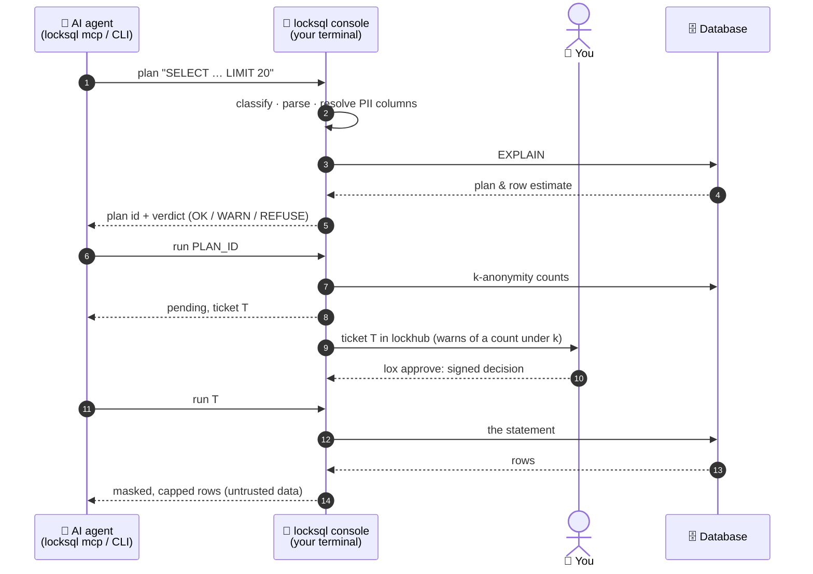

# How locksql works, in detail

The [README](../README.md#how-it-works) has the short version. The full walkthrough of a session is in [usage.md](usage.md).

## Two processes, one key holder

Two processes in two containers. Only the console holds the key.



1. The agent submits SQL with `locksql plan` (or the `locksql_plan` MCP tool).
   The console classifies it, parses and analyses a read down to the source
   column of every output, runs `EXPLAIN`, weighs the plan and returns a
   one-shot plan id with a verdict (`OK`, `WARN` or `REFUSE`).
2. The agent calls `locksql run PLAN_ID`. When the statement filters, groups
   or aggregates PII, the console first runs its k-anonymity counts. It prints
   the approval screen in its terminal, sends the request to lockhub as a
   ticket (every literal masked, with a `k-anonymity` warning for each count
   under `k_anonymity`) and answers the agent `pending` with the ticket:

   ```
   ╭─ DEV · 127.0.0.1 / app · user alice · tier read ─────
   │ requested by uid 1000 (alice) · pid 48211 (claude)
   │ agent: list the Belgian customers to check the email campaign
   │
   │   SELECT id, email FROM customers WHERE country = 'BE' LIMIT 20
   │
   │ class READ · EXPLAIN: customers range ~410 · est. 410 rows examined · verdict OK
   │ reads: app.customers
   │ returns at most 20 rows
   │ PII columns touched: customers.email (select)
   │ masked outputs: email → redact
   │ PII: masked (4 column rules; detectors: email, phone, iban, card)
   ╰─ pending: ticket 01J…
   ```

3. You decide the ticket in lockhub (`lox approve`). The agent runs the
   ticket (`locksql run TICKET`); the console checks the hub's signed
   decision, plans the statement again, runs it, masks PII, caps the output
   and hands the rows back to the agent, framed as untrusted data.

<details>
<summary>Process layout</summary>

```
 Console container (your terminal)                Agent's container
 ┌───────────────────────────────────┐            ┌──────────────────────────────┐
 │ locksql console --profile dev     │ socket     │ locksql mcp   (stdio MCP)    │◄── AI agent
 │  credentials (ask | Vault)        │ volume     │ locksql plan|run|status|pii  │◄── AI via shell
 │  policy · classifier · EXPLAIN    │◄──────────►│ no secrets, no DB connection │
 │  approval prompt · masking · audit│  JSON-RPC  └──────────────────────────────┘
 └─────────────────┬─────────────────┘
                   │ native protocol
                   ▼
        MariaDB · MySQL · PostgreSQL · SQLite
```

</details>

Every client command, `locksql mcp` and `locksql doctor` also take `--instance NAME`, to
reach one lock among several of this type that lea mounts (without it:
`$LOCKSQL_INSTANCE`, else the one lock in `$LEA_LOCKSQL_INSTANCES`). `locksql console`
and `locksql hub-key` take an `--instance` too, but that one is the name `lox run`
gives the lock.

Full walkthrough: [docs/usage.md](usage.md).

## Engines

| Engine | Versions | Read-only session (tier `read`) | Server-side timeout | Plan source |
|---|---|---|---|---|
| `mariadb` | 10.1+ (tested 10.11, 11.4) | `SET SESSION TRANSACTION READ ONLY` + `START TRANSACTION READ ONLY` | `max_statement_time` + `KILL QUERY` | `EXPLAIN FORMAT=JSON` |
| `mysql` | 8.0+ (tested 8.0, 8.4) | same as MariaDB | `max_execution_time` (SELECT only; writes rely on `KILL QUERY`) + `KILL QUERY` | `EXPLAIN FORMAT=JSON` |
| `postgres` | 13+ (tested 13, 17) | `SET SESSION CHARACTERISTICS AS TRANSACTION READ ONLY` + `BEGIN READ ONLY` … `ROLLBACK` | `statement_timeout` + cancel request | `EXPLAIN (FORMAT JSON, VERBOSE)` |
| `sqlite` | 3 (pure Go, in-process) | `mode=ro` + `query_only` | interrupt on deadline | `EXPLAIN QUERY PLAN` + `sqlite_stat1` (run `ANALYZE` once, or every full scan is a WARN of unknown size) |

All engines are pure Go: the binary is built with `CGO_ENABLED=0`. locksql
runs in Linux containers, on amd64 and arm64, wherever Docker runs
([docs/docker.md](docker.md)).
